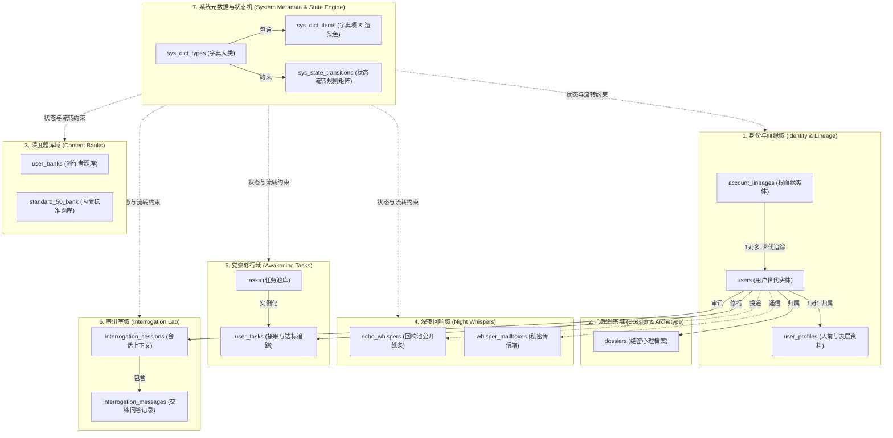
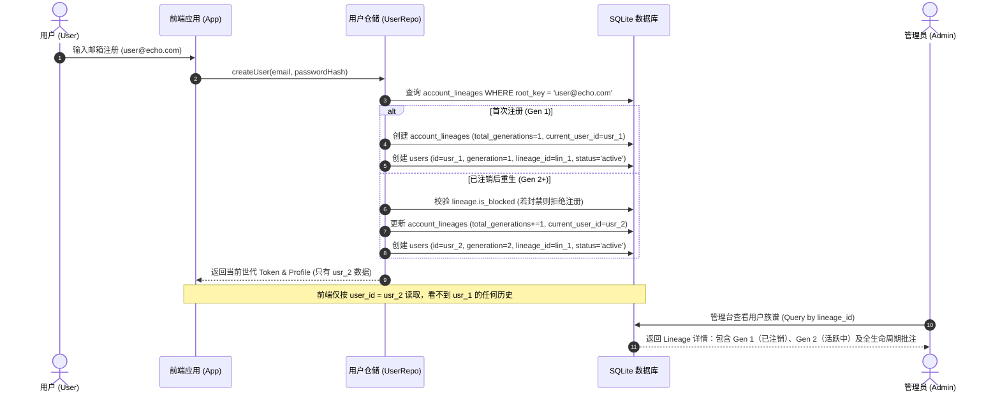
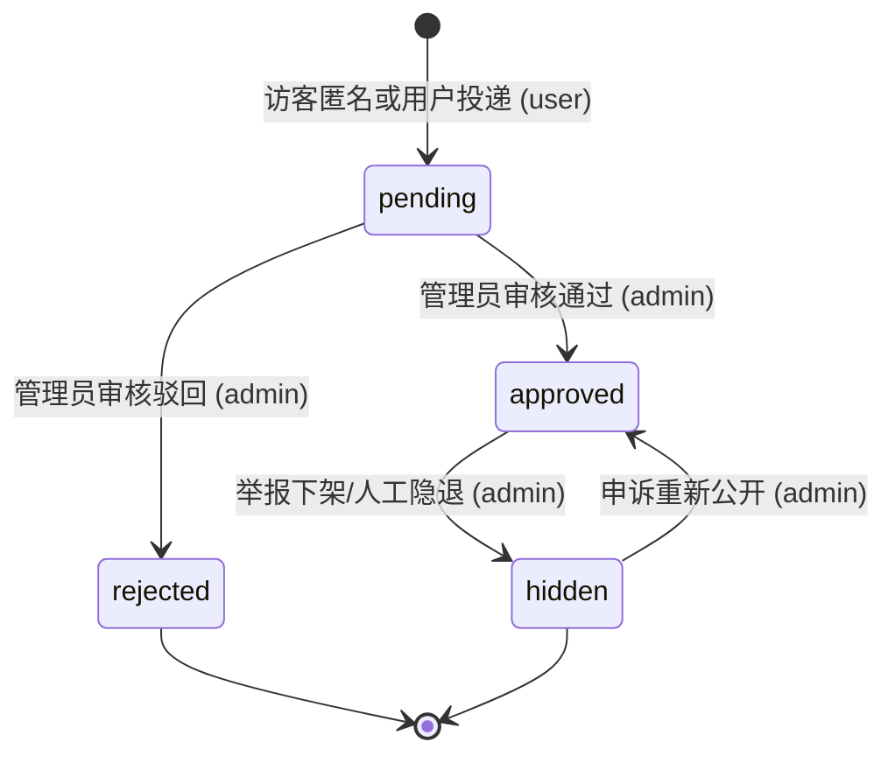
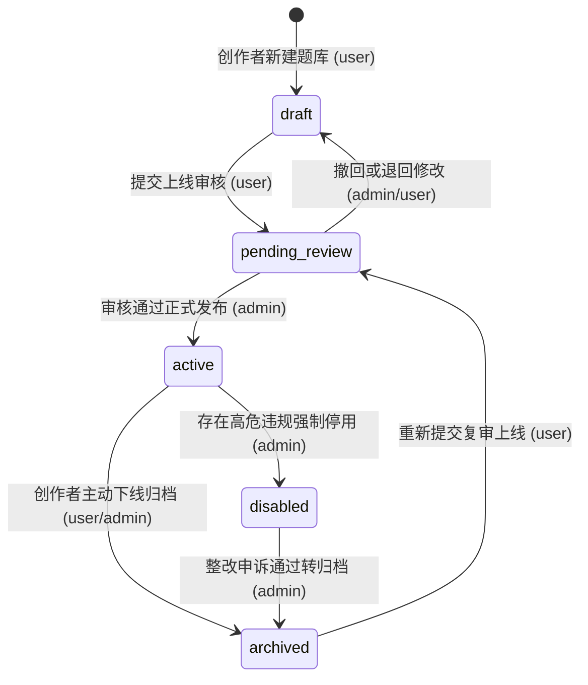
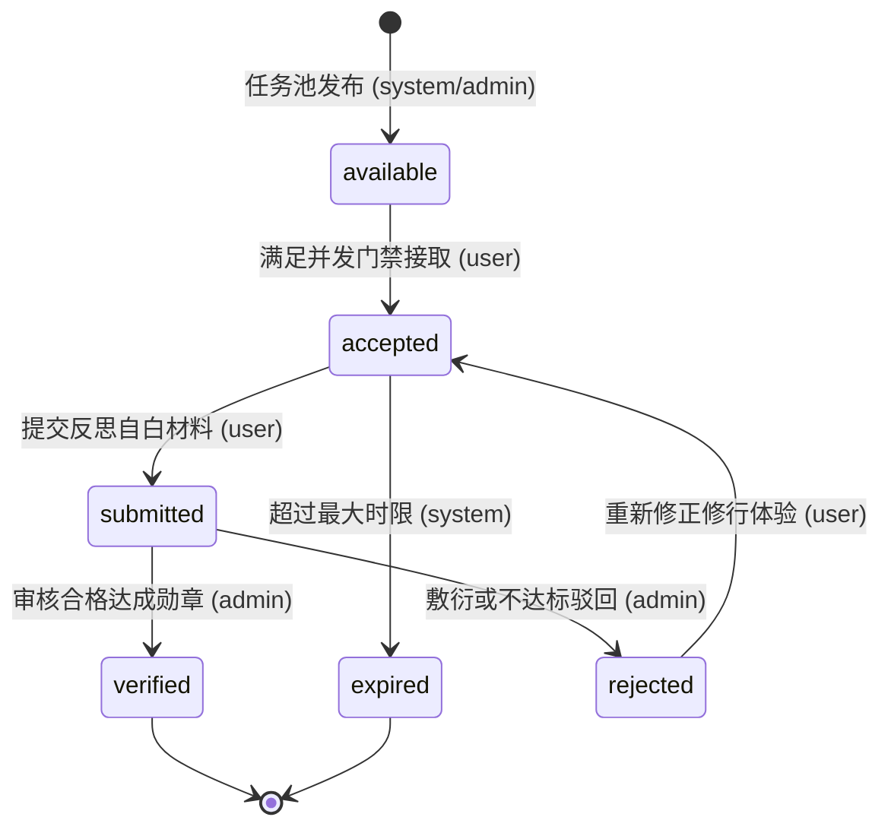
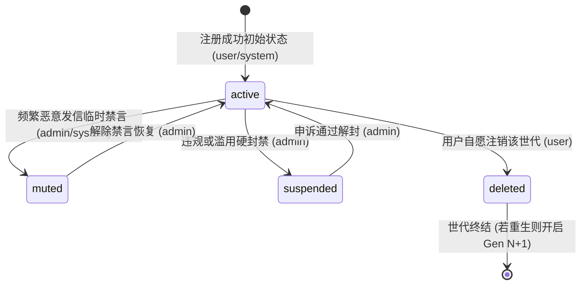

# InnerEcho 业务领域、数据库规范与重构设计说明书
# (Business Architecture, Database Specification & Admin Refactor Plan)

> **生效日期**：2026-11-06  
> **适用范围**：InnerEcho 核心服务端（`server/`）、数据访问层（`server/db/`）、管理控制台（`src/admin/`）与数据迁移系统。  
> **核心原则**：保持 1GB VPS 内存极简架构（0MB 服务端额外常驻开销）、代码单文件严控 1000 行以内、业务状态字典化零硬编码、账号血缘前后端隔离分治、全业务全链路显式备注留痕。

---

## 一、 架构愿景与业务领域全景 (Architecture & Domain Overview)

### 1.1 架构约束与选型背景
InnerEcho 运行于 1GB 内存极简 VPS 服务器上。过去系统采用 SQLite (`better-sqlite3` + WAL 模式) 保证了卓越的轻量与极速响应（内存常驻 15~30MB）。但在业务持续迭代中积累了若干痛点：
1. **状态字符串硬编码散落**：审核状态、任务进度、账号状态等在前端、后端路由、DB 脚本中散落大量 `'approved'`, `'pending'`, `'accepted'` 字符串判定与手写颜色分支，缺乏统一元数据源，无法在线动态扩展。
2. **账号注销与再注册的血缘割裂**：用户自愿注销后重新注册，在前端虽然实现了崭新开局，但在后端缺乏根血缘（Account Lineage）串联，导致无法跨世代追溯风控历史、滥用记录与生命周期审计。
3. **单文件规模膨胀**：`migrations.ts`（993行）、`server/routes/admin.ts`（787行）等核心文件逼近 1000 行警戒线，亟需按业务域解耦拆分。
4. **备注与运营批注字段缺失**：许多实体表缺少明确的 `remark`（系统备注）与 `admin_notes`（管理员私密运营批注）字段，人工介入审核或异常处理时无法留痕。

### 1.2 业务域边界定义 (Bounded Contexts)
系统划分为以下 7 大业务领域：



---

## 二、 账号血缘与世代重生规范 (Account Lineage & Reincarnation System)

### 2.1 业务诉求与设计核心
- **前端极致隐私隔离（User Privacy Isolation）**：
  用户注销账号后重新注册同一凭据（邮箱/身份），在用户端视角下必须是**彻底纯净的新账号**（Generation + 1）。旧世代的心理测试自白、深夜回响、修行任务进度一律物理隔离，前端不可查、不可见，绝无历史残留或心理负担。
- **后端全生命周期风控与血缘关联（Backend Lineage Correlation）**：
  在系统后端与管理员视角下，同一主凭据（邮箱）归属于同一个根血缘（`account_lineages`）。系统能清晰统计该血缘下的总重生代数、各代存续周期、跨世代累计风控等级、管理员风控留痕与封禁关联。

### 2.2 数据模型设计

#### 2.2.1 根血缘表 `account_lineages`
```sql
CREATE TABLE IF NOT EXISTS account_lineages (
  id TEXT PRIMARY KEY,                       -- 如 'lin_01j7...'
  root_key TEXT UNIQUE NOT NULL,             -- 根标识：标准化小写邮箱（如 'user@domain.com'）
  first_registered_at TEXT NOT NULL,         -- 首次创世注册时间 (ISO8601)
  last_active_at TEXT NOT NULL,              -- 跨世代最后活跃时间 (ISO8601)
  total_generations INTEGER NOT NULL DEFAULT 1, -- 历史重生总世代数 (1, 2, 3...)
  current_user_id TEXT,                      -- 当前存活世代 user_id（注销期间为 NULL）
  risk_level TEXT NOT NULL DEFAULT 'normal', -- 风控等级: normal / low / medium / high / blocked
  is_blocked INTEGER NOT NULL DEFAULT 0,     -- 根血缘级硬封禁 (1=封禁，所有世代禁止登录/注册)
  admin_notes TEXT,                          -- 管理员私密运营批注与风控备忘
  remark TEXT,                               -- 系统或业务备注
  created_at TEXT NOT NULL,
  updated_at TEXT NOT NULL
);
CREATE INDEX IF NOT EXISTS idx_account_lineages_root_key ON account_lineages(root_key);
CREATE INDEX IF NOT EXISTS idx_account_lineages_risk ON account_lineages(risk_level, is_blocked);
```

#### 2.2.2 用户实体表 `users` 改造（新增字段）
```sql
-- 字段定义：
-- lineage_id: 外键关联 account_lineages(id)
-- account_status: 关联字典 user_account_status (active / muted / suspended / deleted)
-- admin_notes: 管理员针对该特定世代的批注
-- remark: 系统针对该特定世代的业务备注

ALTER TABLE users ADD COLUMN lineage_id TEXT REFERENCES account_lineages(id);
ALTER TABLE users ADD COLUMN account_status TEXT NOT NULL DEFAULT 'active';
ALTER TABLE users ADD COLUMN admin_notes TEXT;
ALTER TABLE users ADD COLUMN remark TEXT;

CREATE INDEX IF NOT EXISTS idx_users_lineage_id ON users(lineage_id);
CREATE INDEX IF NOT EXISTS idx_users_account_status ON users(account_status);
```

### 2.3 世代重生生命周期流程



---

## 三、 动态数据字典架构规范 (Dynamic Data Dictionary System)

### 3.1 核心设计意图
1. **消灭字符串硬编码**：禁止在前后端业务逻辑中出现散落的 `'approved'`, `'rejected'` 文本以及硬编码的颜色代码（如 `status === 'approved' ? 'green' : 'red'`）。
2. **零停机动态扩展**：允许管理员在管理后台在线新增状态标签、调整展示顺序、更换 Badge 配色，前台管理端即时生效。
3. **全链路显式备注**：每个字典类型、字典项均配备 `remark` 字段，严禁“无业务说明的神秘枚举”。

### 3.2 字典数据表设计

#### 3.2.1 字典类型表 `sys_dict_types`
```sql
CREATE TABLE IF NOT EXISTS sys_dict_types (
  code TEXT PRIMARY KEY,                     -- 字典唯一编码，如 'user_account_status'
  name TEXT NOT NULL,                        -- 字典中文名，如 '用户账号状态'
  description TEXT,                          -- 业务用途详细说明
  remark TEXT,                               -- 系统/开发备注
  is_system INTEGER NOT NULL DEFAULT 1,      -- 是否系统预置字典 (1=只读系统字典，不可删除；0=自定义)
  created_at TEXT NOT NULL,
  updated_at TEXT NOT NULL
);
```

#### 3.2.2 字典数据项表 `sys_dict_items`
```sql
CREATE TABLE IF NOT EXISTS sys_dict_items (
  id TEXT PRIMARY KEY,                       -- 如 'ditem_01j7...'
  type_code TEXT NOT NULL,                   -- 外键关联 sys_dict_types(code) ON DELETE CASCADE
  value TEXT NOT NULL,                       -- 状态枚举值，如 'active', 'suspended'
  label TEXT NOT NULL,                       -- 中文展示标签，如 '正常活跃', '已封禁'
  badge_color TEXT NOT NULL DEFAULT 'gray',  -- Mantine 颜色: teal, red, yellow, blue, gray, violet 等
  badge_variant TEXT NOT NULL DEFAULT 'light',-- Mantine variant: light, filled, outline, subtle
  sort_order INTEGER NOT NULL DEFAULT 0,     -- 排序权重 (数字越小越靠前)
  is_default INTEGER NOT NULL DEFAULT 0,     -- 是否新建记录时的默认值 (1=是, 0=否)
  is_active INTEGER NOT NULL DEFAULT 1,      -- 是否启用 (1=启用, 0=禁用下线)
  remark TEXT,                               -- 该项业务含义说明与适用场景备注
  created_at TEXT NOT NULL,
  updated_at TEXT NOT NULL,
  UNIQUE(type_code, value)
);
CREATE INDEX IF NOT EXISTS idx_dict_items_type ON sys_dict_items(type_code, sort_order ASC);
```

### 3.3 系统内置 6 大核心业务字典规范

| 字典编码 (`type_code`) | 字典名称 | 业务归属域 | 枚举项 (`value` / `label` / `badge_color`) | 业务备注 (`remark`) |
| :--- | :--- | :--- | :--- | :--- |
| **`user_account_status`** | 用户账号状态 | 身份与血缘域 | - `active` (正常活跃 / `teal`)<br>- `muted` (禁言受限 / `yellow`)<br>- `suspended` (账号封禁 / `red`)<br>- `deleted` (已注销 / `gray`) | 控制用户登录、发信、接取任务等核心权限。注销状态对应软删除。 |
| **`echo_audit_status`** | 深夜回响审核状态 | 深夜回响域 | - `pending` (待审核 / `yellow`)<br>- `approved` (公开展示 / `teal`)<br>- `rejected` (驳回违规 / `red`)<br>- `hidden` (隐退下架 / `gray`) | 控制广场回响池纸条的可见性。违规驳回需填写管理员批注。 |
| **`bank_audit_status`** | 题库审核状态 | 深度题库域 | - `draft` (草稿编写 / `gray`)<br>- `pending_review` (提交审核 / `blue`)<br>- `active` (正式上线 / `teal`)<br>- `archived` (下线归档 / `violet`)<br>- `disabled` (强制停用 / `red`) | 创作者题库与官方卷宗全流程管控。强制停用用于侵权或高风险题库。 |
| **`dossier_audit_status`** | 心理卷宗封存状态 | 心理卷宗域 | - `draft` (测评中 / `gray`)<br>- `sealed` (绝密封存 / `teal`)<br>- `archived` (历史归档 / `violet`) | 用户 50 题卷宗答题完成生成报告后自动封存，注销时归档。 |
| **`task_progress_status`**| 修行任务接取状态 | 觉察修行域 | - `available` (待接取 / `blue`)<br>- `accepted` (修行中 / `yellow`)<br>- `submitted` (已提交待验 / `indigo`)<br>- `verified` (达成通过 / `teal`)<br>- `rejected` (未达标驳回 / `red`)<br>- `expired` (已逾期失效 / `gray`) | 严格双并发接取上限与接取-提交-审核-达成全流程。 |
| **`interrogation_status`** | 审讯室会话状态 | 审讯室域 | - `active` (审讯交锋中 / `teal`)<br>- `completed` (圆满达成 / `blue`)<br>- `terminated` (异常熔断 / `red`) | 审讯室 AI 对话状态控制，达到轮数或触发风控时终止。 |

---

## 四、 动态有限状态机流转引擎 (Dynamic State Machine Engine)

### 4.1 核心设计意图
状态的变更不能由前端或普通接口随意篡改。例如：
- 未通过审核的草稿题库**决不允许直接上线**；
- 已达成的修行任务**决不允许倒流回接取中**；
- 驳回的回响在修改后**允许重新提交审核**，但不能由创作者直接改为通过。

全系统通过 `sys_state_transitions` 表定义“当前状态 -> 目标状态”的合法流转动作、所需权限以及备注约束。

### 4.2 状态流转规则表 `sys_state_transitions`
```sql
CREATE TABLE IF NOT EXISTS sys_state_transitions (
  id TEXT PRIMARY KEY,                       -- 如 'stran_01j7...'
  type_code TEXT NOT NULL,                   -- 关联 sys_dict_types(code)
  from_value TEXT NOT NULL,                  -- 当前状态值
  to_value TEXT NOT NULL,                    -- 目标状态值
  action_name TEXT NOT NULL,                 -- 动作名称（如 '提交审核', '审核通过', '违规驳回', '强制归档'）
  required_role TEXT NOT NULL DEFAULT 'admin',-- 触发权限: user / admin / system
  is_allowed INTEGER NOT NULL DEFAULT 1,     -- 是否开放流转 (1=允许, 0=阻断)
  remark TEXT,                               -- 流转前置业务规则与约束说明
  created_at TEXT NOT NULL,
  updated_at TEXT NOT NULL,
  UNIQUE(type_code, from_value, to_value, action_name)
);
CREATE INDEX IF NOT EXISTS idx_state_transitions_lookup 
  ON sys_state_transitions(type_code, from_value, is_allowed);
```

### 4.3 核心业务状态转移全景矩阵

#### 4.3.1 深夜回响审核流转 (`echo_audit_status`)


#### 4.3.2 创作者题库生命周期 (`bank_audit_status`)


#### 4.3.3 修行任务流转生命周期 (`task_progress_status`)


#### 4.3.4 用户账号状态流转 (`user_account_status`)


---

## 五、 统一备注与批注字段规范 (Unified Remark & Notes Standard)

系统严格规范全表备注字段职责，杜绝“字段含义模糊”与“无理由状态变更”：

| 字段名称 | 访问权限 | 适用对象 | 业务语义与使用规范 |
| :--- | :--- | :--- | :--- |
| **`remark`** | 业务系统公开 / 内部通用 | 所有实体、字典、规则表 | **系统业务备注**。记录系统触发事件、自动降级原因、第三方关联标识、规则建立初衷。前端按需可读，无机密风控信息。 |
| **`admin_notes`** | 仅管理端 (Admin Only) | 核心实体（`account_lineages`, `users`, `echo_whispers`, `user_banks` 等） | **管理员私密批注**。记录人工运营审核记录、风控调查询问记录、申诉受理理由、敏感用户标签。**严禁暴露给前端普通用户！** |
| **`description`** | 公开可读 | 元数据定义（`sys_dict_types`, `tasks`, `user_banks`） | **功能/描述文案**。面向用户或运营人员解释该模块、该题库或该字典大类的官方业务功能定位。 |

---

## 六、 数据库迁移与解耦落地策略 (Migration Architecture)

### 6.1 解决 `migrations.ts` 单文件逼近 1000 行
目前 `server/db/migrations.ts` 为 993 行。遵守 `AGENTS.md` Rule 10 规范，本次迁移对迁移框架实施**模块化解耦重构**：
1. 提取历史版本迁移定义：将 v1 ~ v35 归档放入 `server/db/migrations/legacyMigrations.ts`（只读历史归档）。
2. 新版本独立维护：新建 `server/db/migrations/v36.ts`，专职负责血缘与字典初始化。
3. `server/db/migrations.ts` 精简为总调度执行器，常态维持在 100 行左右，代码优雅且终身不再超标。

### 6.2 Migration v36 具体执行计划
1. **创建核心表**：
   - 创建 `account_lineages` 根血缘表。
   - `users` 表安全添加 `lineage_id`, `account_status`, `admin_notes`, `remark` 列（通过 `ensureColumn`）。
   - 创建 `sys_dict_types`, `sys_dict_items`, `sys_state_transitions` 表及其唯一索引。
2. **存量数据平滑回填 (Backfill)**：
   - 扫描存量 `users` 表，按 `LOWER(email)` 聚合：
     - 若该邮箱尚未建立血缘，则插入一条 `account_lineages`（`root_key = LOWER(email)`, `total_generations = MAX(generation)`, `first_registered_at = MIN(created_at)`, `current_user_id = (最新未注销用户 ID)`）；
     - 将所有对应存量 `users` 行的 `lineage_id` 回填为对应血缘 ID；
     - 若 `users.deleted_at IS NOT NULL` 则将 `account_status` 置为 `'deleted'`，否则置为 `'active'`。
3. **注入内置 6 大字典与初始流转规则**：
   - 全量预置上述 6 大字典类型；
   - 插入 24+ 个标准字典项（自带 Mantine badge 颜色与排序）；
   - 插入 20+ 条核心状态流转矩阵规则。

---

## 七、 管理端 Mantine v7+ 全景重构落地路线图 (Admin Refactor Roadmap)

### 7.1 前端 Mantine 组件库统一封装 (`src/admin/components/ui/`)
在已引入 Mantine v7+ 的基础上，提供企业级可复用构件：

1. **`<AdminWorkbenchShell>`**（已完成并在审讯室验证）：
   - 统一头部、图标、标题、副标题胶囊说明；
   - 统一无边框玻璃感刷新按钮与 `Loader`；
   - 响应式自适应容器与 Mantine 主题联动。
2. **`<DictBadge dictCode="..." value="..." />`**：
   - 根据字典编码和当前状态值，自动呈现对应颜色、变体与本地化 Label；
   - 彻底消灭管理端各列表手工书写的条件配色。
3. **`<DictSelect dictCode="..." />`**：
   - 通用字典下拉选择器，用于列表筛选或表单编辑。
4. **`<StateTransitionButtonGroup>`**：
   - 传入实体类型、当前状态值、实体 ID；
   - 组件自动向后端请求该状态允许的下一步 transitions，并渲染对应颜色的操作按钮（如“通过”、“驳回”、“归档”）；
   - 点击弹出 Mantine `<Modal>`，强制要求录入 `admin_notes`（管理员批注），实现审核留痕。
5. **`adminNotify`**（已封装并在审讯室验证）：
   - 全局 Mantine Notifications，支持 `adminNotify.success / error / info`，消灭本地 `ToastMessage` 状态。

### 7.2 管理端后端路由治理规划 (`server/routes/admin.ts`)
目前 `server/routes/admin.ts` 为 787 行单文件。在后续功能对接中，将其解耦为领域子路由，挂载至主路由：
- `server/routes/admin/adminDict.ts`：字典查询与动态增删改查。
- `server/routes/admin/adminLineage.ts`：账号血缘、族谱追溯与风控批注。
- `server/routes/admin/adminUser.ts`：世代用户详情、会话与资料管理。
- `server/routes/admin/adminEcho.ts`：回响池审核与下架。
- `server/routes/admin/adminBank.ts`：创作者题库全生命周期审核。
- `server/routes/admin/adminTask.ts`：修行任务达成审核与配额管理。

---

## 八、 门禁与验证策略 (Testing & Verification Strategy)

1. **静态类型审查**：
   - `npm run typecheck` 必须 0 错误。
   - `shared/apiContracts.ts` 与 `server/types.ts` 数据结构保持强类型一致。
2. **自动化测试套件回归**：
   - 确保全套 75 个测试文件、406+ 个单元测试全部通过。
   - 新增 `server/db/migrations.test.ts` 针对 v36 迁移脚本的覆盖测试（测试血缘回填、字典初始化、非法状态机流转阻断）。
3. **零服务端内存增量与双产物构建**：
   - 运行 `npm run build`，验证 `dist-user`（用户端纯净，无任何 Mantine 与 Admin 代码泄露）与 `dist-admin`（管理端高奢工作台）双端秒级构建成功。

---

## 九、 AI 智能体与提示词中台现代化架构 (AI Agent & Prompt Hub)

详细业务设计、数据库字段设计与版本快照机制参见独立专项规范：[`docs/AI-AGENT-PROMPT-SPEC.md`](./AI-AGENT-PROMPT-SPEC.md)。

### 9.1 核心资产整合
- 将原本散落的卷宗诊断提示词、审讯室系统提示词与总结提示词，统一抽象为三大内置智能体：`agent_dossier_analyst`、`agent_interrogator`、`agent_interrogation_recorder`。
- 引入不可变版本快照表 `prompt_versions`，通过 `active_version_id` 实现秒级回滚与变更审计。
- 引入动态变量插值引擎 `sys_prompt_variables` 与防注入护栏，解耦 TS 字符串死板硬编码。
- 提供后台 Playground 演练沙盒，免做题一键加载真实卷宗实施 Dry-Run 校验。


